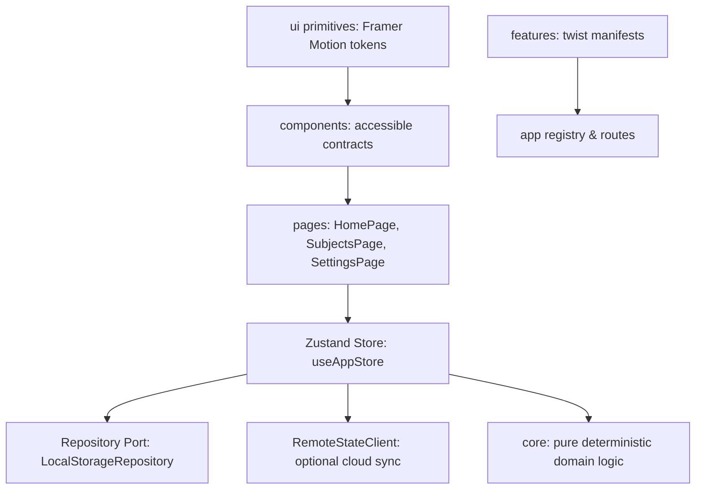

# सा Wallah (Syllabus Wallah)

> **"syllabus ka scene ab ekdam clean"**  
> An intelligent, calm study runway and exam preparation tracker designed for students.

[](https://github.com/Smirk1308/student_tracker)
[](https://github.com/Smirk1308/student_tracker)
[](https://github.com/Smirk1308/student_tracker)
[](LICENSE)

---

## 🎯 Overview & Value Proposition

College students constantly juggle multiple subjects, shifting exam schedules, and extensive course syllabi. Traditional to-do apps treat syllabus topics as generic tasks without calendar awareness or urgency forecasting.

**Syllabus Wallah** introduces a flight runway metaphor for exam prep:
- **Map the Runway**: Divide subjects into granular, ordered syllabus topics.
- **Track Progress & Distance**: Live countdowns and percentage completion computed with deterministic, pure domain logic.
- **Simulate the Unexpected ("Exam Rush")**: What happens when an exam date is suddenly moved 3 days earlier? With one click, the app recalculates required topic-per-day velocity, evaluates load conditions (`comfortable`, `tight`, `at-risk`), surfaces unfinished topics with human-readable priority reasoning, and provides a 1-click restore/undo.

---

## 🏛️ Architecture & Clean Layering

The codebase enforces a strict unidirectional layered architecture. Architecture constraints are automatically validated via `node scripts/check-layers.mjs`.



### Layer Responsibilities

| Layer | Directory | Invariant & Responsibilities |
| :--- | :--- | :--- |
| **Pure Core** | `src/core/` | Zero React or DOM dependencies. All functions are pure and receive `today` explicitly as a string (`YYYY-MM-DD`). |
| **Domain Rules** | `src/core/rules/` | Registered business logic (e.g. `loadStatus` with thresholds: `comfortable` ≤ 0.6, `tight` ≤ 1.0, `at-risk` > 1.0). |
| **Data Port** | `src/data/` | Hexagonal `Repository` abstraction. LocalStorage is primary; `RemoteStateClient` provides non-blocking cloud backup. |
| **Store** | `src/store/` | Centralized Zustand store with defensive deep-cloning and a 10-step rolling undo snapshot history. |
| **UI Primitives** | `src/ui/` | Shared motion tokens (`motionTokens`), reduced-motion accessibility, and original SVG runway visuals. |
| **Components** | `src/components/` | Semantic presentational contracts with full ARIA live regions and keyboard accessibility. |
| **Pages** | `src/pages/` | Route-level composition (`/`, `/subjects`, `/settings`, `/design`). Never computes domain logic directly. |

---

## 📹 Video Walkthrough & Demo

A full video demonstration of the application, showing topic management, live progress tracking, and the exam rush simulation is stored in the repository:
- **Demo Video**: [`demo video/syllabus_wallah_videodemo.mp4`](demo%20video/syllabus_wallah_videodemo.mp4) *(Tracked with Git LFS)*

---

## ⚡ 3-Step Demo Path for Judges

1. **Step 1: Create a Subject & Topic Runway**
   - Navigate to **"My syllabus"**.
   - Add a subject (e.g., *Operating Systems*) and set its target exam date.
   - Add granular syllabus topics (e.g., *Virtual Memory*, *Process Scheduling*).
2. **Step 2: Track Live Progress**
   - Check off a completed topic.
   - Observe the numeric progress bar and calendar countdown instantly recompute.
3. **Step 3: Simulate Exam Rush**
   - Click **"⚡ Move next exam 3 days earlier"**.
   - Observe the **Rush Impact Analysis**:
     - Pre-rush vs. Post-rush topics/day study velocity.
     - Dynamic load condition chip (`comfortable`, `tight`, `at-risk`).
     - Prioritized study list ranking unfinished topics by urgency with explainable reasons.
   - Click **"Undo"** or **"↺ Restore original exam date"** to demonstrate complete reversibility.

---

## 🛠️ Tech Stack

- **Frontend**: React 18, TypeScript 5.7, Vite 6, Tailwind CSS 3.4
- **State Management**: Zustand 4.5 (with rolling 10-snapshot undo history)
- **Animations & Motion**: Framer Motion 11 (`prefers-reduced-motion` compliant)
- **Date Engine**: `date-fns` 3.6 (calendar-safe UTC date difference)
- **Testing**: Vitest 2.1 (13 pure domain unit tests)
- **Backend API**: Node.js, Express 4.21, CORS
- **Cloud Database**: Supabase PostgreSQL with Row Level Security (RLS)
- **Deployment**: Vercel (Frontend static SPA) + Render (Backend Node API)

---

## 🚀 Getting Started

### Prerequisites
- Node.js 18+ and npm

### Installation & Development
```bash
# Clone the repository
git clone https://github.com/Smirk1308/student_tracker.git
cd student_tracker

# Install all monorepo dependencies
npm install

# Start local frontend development server
npm run dev
# App will be accessible at http://localhost:5173
```

### Running Checks & Tests
```bash
# 1. Full monorepo TypeScript typecheck & layer linting
npm run check

# 2. Run pure domain unit test suite (Vitest)
npm test

# 3. Production build (frontend bundle + backend compilation)
npm run build
```

---

## 🔒 Security & Privacy

- **Offline-First Authority**: Student data is stored privately in browser `localStorage`.
- **Schema Validation**: All imported JSON and remote responses are validated with strict runtime schema guards (`validateImport`).
- **Database Row Level Security**: Supabase table `student_states` has RLS enabled with client access revoked; all operations flow through the authenticated backend API.
- **Content Security Policy**: `vercel.json` defines strict CSP headers with `media-src`, `img-src`, and `connect-src` restrictions.

---

## 👥 Contributors

Built for Collaborative Development and DevOps Showcase:
- **Shubh Sharma** ([@Smirk1308](https://github.com/Smirk1308)) - Project Overseer, Architecture & DevOps
