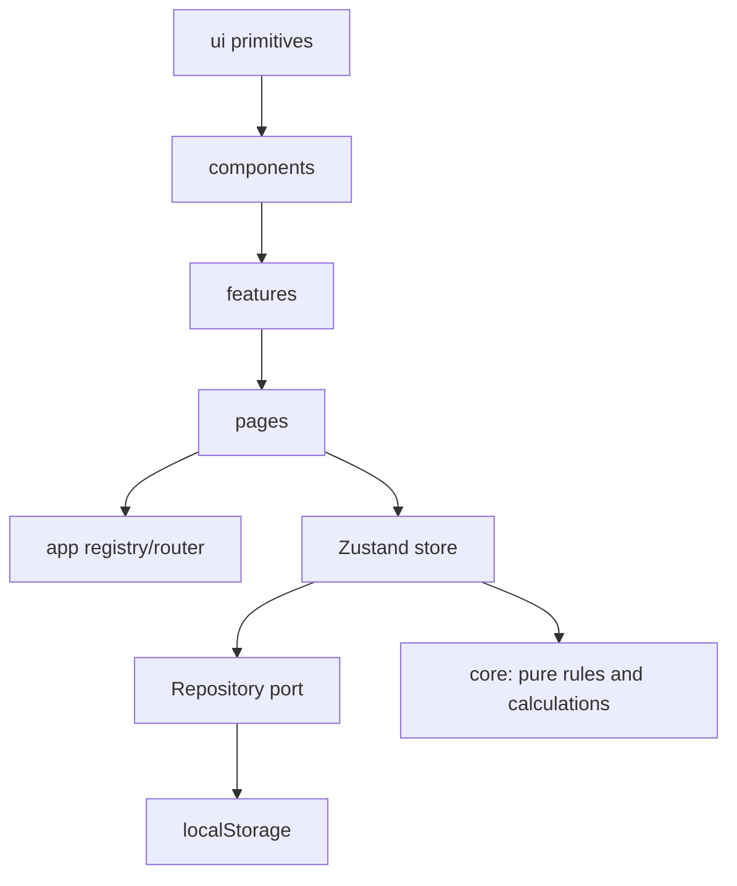

# Architecture

Decisions: HashRouter supports static hosting; localStorage is the only persistence; core receives `today` so it is deterministic; a registry makes later surprises additive; UI owns motion and pages only compose it.
